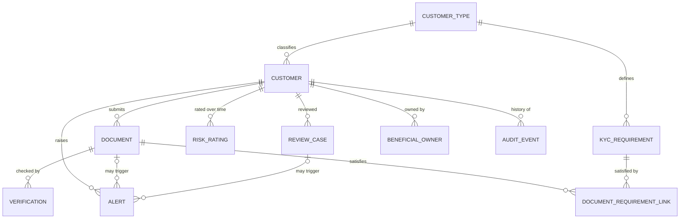

## Relationship Cardinality Notes

| Relationship | Cardinality | Description |
|---|---|---|
| `CustomerType` → `Customer` | 1:N | Every customer has exactly one type. |
| `CustomerType` → `KYCRequirement` | 1:N | Requirements are defined per customer type and risk level. |
| `Customer` → `Document` | 1:N | A customer may initially have zero documents. |
| `Document` → `Verification` | 1:N | A re-check adds a new row; previous verification records are retained. |
| `Customer` → `RiskRating` | 1:N | Risk rating history is preserved. Exactly one rating is current (`effective_to IS NULL`). |
| `Customer` → `ReviewCase` | 1:N | At most one review case per customer per year. |
| `Customer` → `BeneficialOwner` | 1:N | Applicable to business customers only. |
| `Customer` → `Alert` | 1:N | A customer can have multiple alerts. |
| `Document` / `ReviewCase` → `Alert` | 1:N, optional | An alert may reference a document or a review case, depending on its type. |
| `Document` ↔ `KYCRequirement` | N:M | Linked through `DocumentRequirementLink`, the only bridge table. It records which requirement each document was counted against. |
| Any entity → `AuditEvent` | 1:N (soft reference) | Uses `entity_type` and `entity_id` without a hard foreign key. This is a normal pattern for audit logs. |