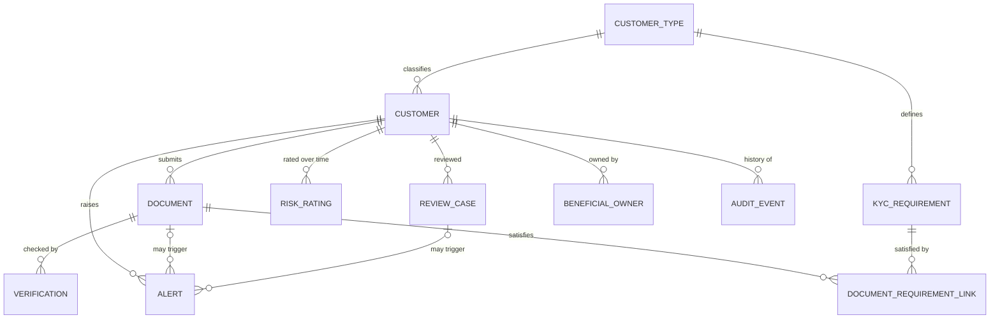

Relationship	Cardinality	Notes
CustomerType → Customer	1:N	Every customer has exactly one type
CustomerType → KYCRequirement	1:N	Requirements are defined per type and risk level
Customer → Document	1:N	A customer may have zero documents at first
Document → Verification	1:N	A re-check adds a row; the old one stays
Customer → RiskRating	1:N	History kept; exactly one is current (effective_to IS NULL)
Customer → ReviewCase	1:N	At most one per customer per year
Customer → BeneficialOwner	1:N	Business customers only
Customer → Alert	1:N	
Document / ReviewCase → Alert	1:N, optional	An alert points to a document or a review, depending on its type
Document ↔ KYCRequirement	N:M via DocumentRequirementLink	The only bridge table; shows which requirement each document was counted against
Any entity → AuditEvent	1:N (soft reference)	entity_type + entity_id, so there’s no hard FK. That’s normal for audit logs.