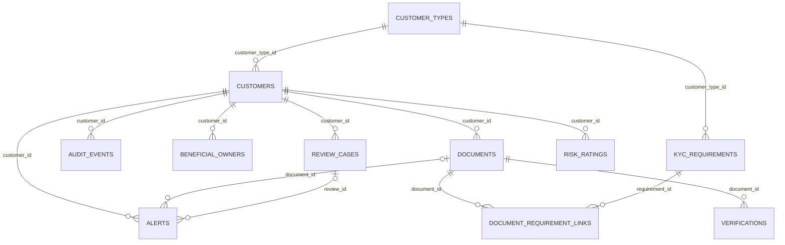

# Schema reference (generated)

Generated from the SQLAlchemy models by `python scripts/make_schema_docs.py`. Do not edit by hand.

## ER diagram

`audit_events.entity_id` is a deliberate soft reference (no FK): one column points at customers, documents, reviews, alerts or ratings.

## customer_types

| Column | Type | Nullable | Keys | Default |
|---|---|---|---|---|
| customer_type_id | VARCHAR(10) | no | PK |  |
| type_code | VARCHAR(20) | no | UNIQUE |  |
| display_name | VARCHAR(60) | no |  |  |
| is_business | BOOLEAN | no |  |  |
| requires_beneficial_owner | BOOLEAN | no |  |  |

- UNIQUE `uq_customer_types_type_code`: (type_code)
- CHECK `ck_customer_types_bo_needs_business`: `NOT requires_beneficial_owner OR is_business`
- CHECK `ck_customer_types_id_format`: `customer_type_id ~ '^CT-[0-9]{2}$'`
- CHECK `ck_customer_types_type_code_valid`: `type_code IN ('INDIVIDUAL', 'SOLE_PROPRIETOR', 'COMPANY')`

## customers

| Column | Type | Nullable | Keys | Default |
|---|---|---|---|---|
| customer_id | VARCHAR(12) | no | PK |  |
| customer_type_id | VARCHAR(10) | no | FK to customer_types.customer_type_id |  |
| legal_name | VARCHAR(200) | no |  |  |
| date_of_birth | DATE | yes |  |  |
| incorporation_date | DATE | yes |  |  |
| country_code | VARCHAR(2) | no |  |  |
| email | VARCHAR(200) | no | UNIQUE |  |
| onboarded_on | DATE | no |  |  |
| kyc_status | VARCHAR(15) | no |  |  |

- UNIQUE `uq_customers_email`: (email)
- CHECK `ck_customers_country_format`: `country_code ~ '^[A-Z]{2}$'`
- CHECK `ck_customers_id_format`: `customer_id ~ '^CUS-[0-9]{6}$'`
- CHECK `ck_customers_person_xor_business_date`: `(date_of_birth IS NULL) <> (incorporation_date IS NULL)`
- CHECK `ck_customers_status_valid`: `kyc_status IN ('PENDING', 'UNDER_REVIEW', 'APPROVED', 'REJECTED', 'SUSPENDED')`
- INDEX `ix_customers_customer_type_id` on (customer_type_id)
- INDEX `ix_customers_kyc_status` on (kyc_status)

## kyc_requirements

| Column | Type | Nullable | Keys | Default |
|---|---|---|---|---|
| requirement_id | VARCHAR(20) | no | PK |  |
| customer_type_id | VARCHAR(10) | no | FK to customer_types.customer_type_id |  |
| risk_level | VARCHAR(10) | no |  |  |
| document_category | VARCHAR(30) | no |  |  |
| is_mandatory | BOOLEAN | no |  |  |
| max_age_days | INTEGER | yes |  |  |
| expiry_lead_days | ARRAY | no |  | {60,30,7} |
| effective_from | DATE | no |  |  |
| effective_to | DATE | yes |  |  |

- UNIQUE `uq_kyc_requirements_rule`: (customer_type_id, risk_level, document_category, effective_from)
- CHECK `ck_kyc_requirements_category_valid`: `document_category IN ('ID_PROOF', 'ADDRESS_PROOF', 'TAX_ID', 'INCORPORATION_CERT', 'BUSINESS_ADDRESS_PROOF', 'OWNERSHIP_PROOF', 'SOURCE_OF_FUNDS')`
- CHECK `ck_kyc_requirements_effective_dates_ordered`: `effective_to IS NULL OR effective_to >= effective_from`
- CHECK `ck_kyc_requirements_id_format`: `requirement_id ~ '^KYC-[0-9]{4}-[0-9]{6}$'`
- CHECK `ck_kyc_requirements_lead_days_positive`: `cardinality(expiry_lead_days) > 0 AND 0 < ALL (expiry_lead_days)`
- CHECK `ck_kyc_requirements_max_age_positive`: `max_age_days IS NULL OR max_age_days > 0`
- CHECK `ck_kyc_requirements_risk_valid`: `risk_level IN ('LOW', 'MEDIUM', 'HIGH')`
- INDEX `ix_kyc_requirements_customer_type_id` on (customer_type_id)

## audit_events

| Column | Type | Nullable | Keys | Default |
|---|---|---|---|---|
| event_id | VARCHAR(12) | no | PK |  |
| customer_id | VARCHAR(12) | no | FK to customers.customer_id |  |
| entity_type | VARCHAR(30) | no |  |  |
| entity_id | VARCHAR(30) | no |  |  |
| action | VARCHAR(20) | no |  |  |
| old_value | JSONB | yes |  |  |
| new_value | JSONB | yes |  |  |
| actor | VARCHAR(40) | no |  |  |
| occurred_at | DATETIME | no |  |  |

- CHECK `ck_audit_events_action_valid`: `action IN ('CREATED', 'STATUS_CHANGED', 'VERIFIED', 'RISK_RATED', 'ALERT_RAISED', 'REVIEW_CLOSED')`
- CHECK `ck_audit_events_id_format`: `event_id ~ '^AUD-[0-9]{6}$'`
- INDEX `ix_audit_events_customer_time` on (customer_id, occurred_at)
- INDEX `ix_audit_events_entity` on (entity_type, entity_id)

## beneficial_owners

| Column | Type | Nullable | Keys | Default |
|---|---|---|---|---|
| owner_id | VARCHAR(12) | no | PK |  |
| customer_id | VARCHAR(12) | no | FK to customers.customer_id |  |
| owner_name | VARCHAR(200) | no |  |  |
| nationality | VARCHAR(2) | no |  |  |
| ownership_pct | NUMERIC(5, 2) | no |  |  |
| is_pep | BOOLEAN | no |  |  |
| effective_from | DATE | no |  |  |
| effective_to | DATE | yes |  |  |

- CHECK `ck_beneficial_owners_effective_dates_ordered`: `effective_to IS NULL OR effective_to >= effective_from`
- CHECK `ck_beneficial_owners_id_format`: `owner_id ~ '^BO-[0-9]{6}$'`
- CHECK `ck_beneficial_owners_nationality_format`: `nationality ~ '^[A-Z]{2}$'`
- CHECK `ck_beneficial_owners_pct_range`: `ownership_pct > 0 AND ownership_pct <= 100`
- INDEX `ix_beneficial_owners_customer_id` on (customer_id)

## documents

| Column | Type | Nullable | Keys | Default |
|---|---|---|---|---|
| document_id | VARCHAR(25) | no | PK |  |
| customer_id | VARCHAR(12) | no | FK to customers.customer_id |  |
| document_category | VARCHAR(30) | no |  |  |
| document_type | VARCHAR(40) | no |  |  |
| document_number | VARCHAR(40) | no |  |  |
| name_on_document | VARCHAR(200) | no |  |  |
| issue_date | DATE | no |  |  |
| expiry_date | DATE | yes |  |  |
| status | VARCHAR(10) | no |  |  |
| submitted_on | DATE | no |  |  |

- CHECK `ck_documents_category_valid`: `document_category IN ('ID_PROOF', 'ADDRESS_PROOF', 'TAX_ID', 'INCORPORATION_CERT', 'BUSINESS_ADDRESS_PROOF', 'OWNERSHIP_PROOF', 'SOURCE_OF_FUNDS')`
- CHECK `ck_documents_expiry_after_issue`: `expiry_date IS NULL OR expiry_date > issue_date`
- CHECK `ck_documents_id_format`: `document_id ~ '^DOC-CUS-[0-9]{6}-[0-9]{3}$'`
- CHECK `ck_documents_id_matches_customer`: `starts_with(document_id, 'DOC-' || customer_id || '-')`
- CHECK `ck_documents_status_valid`: `status IN ('PENDING', 'VALID', 'INVALID', 'EXPIRED')`
- CHECK `ck_documents_submitted_after_issue`: `submitted_on >= issue_date`
- CHECK `ck_documents_type_valid`: `document_type IN ('PASSPORT', 'NATIONAL_ID', 'DRIVING_LICENSE', 'UTILITY_BILL', 'BANK_STATEMENT', 'TAX_CERTIFICATE', 'CERTIFICATE_OF_INCORPORATION', 'SHAREHOLDER_REGISTER', 'SALARY_SLIP')`
- INDEX `ix_documents_customer_id` on (customer_id)
- INDEX `ix_documents_document_number` on (document_number)
- INDEX `ix_documents_expiry_date` on (expiry_date)
- INDEX `ix_documents_status` on (status)

## review_cases

| Column | Type | Nullable | Keys | Default |
|---|---|---|---|---|
| review_id | VARCHAR(25) | no | PK |  |
| customer_id | VARCHAR(12) | no | FK to customers.customer_id |  |
| review_year | INTEGER | no |  |  |
| trigger | VARCHAR(20) | no |  |  |
| scheduled_date | DATE | no |  |  |
| due_date | DATE | no |  |  |
| status | VARCHAR(15) | no |  |  |
| resolution | VARCHAR(25) | yes |  |  |
| assigned_to | VARCHAR(40) | yes |  |  |
| closed_at | DATETIME | yes |  |  |

- UNIQUE `uq_reviews_customer_year`: (customer_id, review_year)
- CHECK `ck_review_cases_closed_at_iff_closed`: `(status = 'CLOSED') = (closed_at IS NOT NULL)`
- CHECK `ck_review_cases_due_after_scheduled`: `due_date >= scheduled_date`
- CHECK `ck_review_cases_id_format`: `review_id ~ '^REV-CUS-[0-9]{6}-[0-9]{4}$'`
- CHECK `ck_review_cases_id_matches_customer_year`: `review_id = 'REV-' || customer_id || '-' || CAST(review_year AS text)`
- CHECK `ck_review_cases_resolution_valid`: `resolution IN ('NO_ISSUES', 'REMEDIATION_REQUIRED', 'ESCALATED', 'RELATIONSHIP_EXITED')`
- CHECK `ck_review_cases_status_valid`: `status IN ('SCHEDULED', 'IN_PROGRESS', 'CLOSED')`
- CHECK `ck_review_cases_trigger_valid`: `trigger IN ('PERIODIC', 'RISK_CHANGE', 'DOCUMENT_EXPIRY')`
- INDEX `ix_review_cases_customer_id` on (customer_id)
- INDEX `ix_review_cases_due_date` on (due_date)
- INDEX `ix_review_cases_status` on (status)

## risk_ratings

| Column | Type | Nullable | Keys | Default |
|---|---|---|---|---|
| rating_id | VARCHAR(12) | no | PK |  |
| customer_id | VARCHAR(12) | no | FK to customers.customer_id |  |
| risk_level | VARCHAR(10) | no |  |  |
| risk_score | INTEGER | no |  |  |
| reason | VARCHAR(200) | yes |  |  |
| rated_by | VARCHAR(40) | no |  |  |
| effective_from | DATE | no |  |  |
| effective_to | DATE | yes |  |  |

- CHECK `ck_risk_ratings_effective_dates_ordered`: `effective_to IS NULL OR effective_to >= effective_from`
- CHECK `ck_risk_ratings_id_format`: `rating_id ~ '^RSK-[0-9]{6}$'`
- CHECK `ck_risk_ratings_level_matches_score`: `(risk_score < 35 AND risk_level = 'LOW') OR (risk_score BETWEEN 35 AND 69 AND risk_level = 'MEDIUM') OR (risk_score >= 70 AND risk_level = 'HIGH')`
- CHECK `ck_risk_ratings_level_valid`: `risk_level IN ('LOW', 'MEDIUM', 'HIGH')`
- CHECK `ck_risk_ratings_score_range`: `risk_score BETWEEN 0 AND 100`
- INDEX `ix_risk_ratings_customer_id` on (customer_id)
- UNIQUE INDEX `uq_risk_ratings_one_current` on (customer_id) WHERE effective_to IS NULL

## alerts

| Column | Type | Nullable | Keys | Default |
|---|---|---|---|---|
| alert_id | VARCHAR(20) | no | PK |  |
| customer_id | VARCHAR(12) | no | FK to customers.customer_id |  |
| document_id | VARCHAR(25) | yes | FK to documents.document_id |  |
| review_id | VARCHAR(25) | yes | FK to review_cases.review_id |  |
| alert_type | VARCHAR(20) | no |  |  |
| lead_days | INTEGER | yes |  |  |
| severity | VARCHAR(10) | no |  |  |
| status | VARCHAR(15) | no |  |  |
| trigger_date | DATE | no |  |  |
| created_at | DATETIME | no |  |  |

- CHECK `ck_alerts_doc_alert_needs_document`: `left(alert_type, 4) <> 'DOC_' OR document_id IS NOT NULL`
- CHECK `ck_alerts_id_format`: `alert_id ~ '^ALT-[0-9]{4}-[0-9]{6}$'`
- CHECK `ck_alerts_lead_days_iff_expiring`: `(alert_type = 'DOC_EXPIRING') = (lead_days IS NOT NULL)`
- CHECK `ck_alerts_lead_days_positive`: `lead_days IS NULL OR lead_days > 0`
- CHECK `ck_alerts_review_alert_needs_review`: `alert_type <> 'REVIEW_OVERDUE' OR review_id IS NOT NULL`
- CHECK `ck_alerts_severity_valid`: `severity IN ('LOW', 'MEDIUM', 'HIGH')`
- CHECK `ck_alerts_status_valid`: `status IN ('OPEN', 'ACKNOWLEDGED', 'RESOLVED')`
- CHECK `ck_alerts_type_valid`: `alert_type IN ('DOC_EXPIRING', 'DOC_EXPIRED', 'REVIEW_OVERDUE', 'MISSING_EVIDENCE', 'OWNERSHIP_ERROR')`
- INDEX `ix_alerts_customer_id` on (customer_id)
- INDEX `ix_alerts_document_id` on (document_id)
- INDEX `ix_alerts_review_id` on (review_id)
- INDEX `ix_alerts_status` on (status)

## document_requirement_links

| Column | Type | Nullable | Keys | Default |
|---|---|---|---|---|
| link_id | VARCHAR(12) | no | PK |  |
| document_id | VARCHAR(25) | no | FK to documents.document_id |  |
| requirement_id | VARCHAR(20) | no | FK to kyc_requirements.requirement_id |  |
| linked_on | DATE | no |  |  |

- UNIQUE `uq_links_pair`: (document_id, requirement_id)
- CHECK `ck_document_requirement_links_id_format`: `link_id ~ '^LNK-[0-9]{6}$'`
- INDEX `ix_document_requirement_links_document_id` on (document_id)
- INDEX `ix_document_requirement_links_requirement_id` on (requirement_id)

## verifications

| Column | Type | Nullable | Keys | Default |
|---|---|---|---|---|
| verification_id | VARCHAR(12) | no | PK |  |
| document_id | VARCHAR(25) | no | FK to documents.document_id |  |
| result | VARCHAR(20) | no |  |  |
| name_match_score | NUMERIC(5, 2) | no |  |  |
| verified_by | VARCHAR(40) | no |  |  |
| verified_at | DATETIME | no |  |  |
| remarks | TEXT | yes |  |  |

- CHECK `ck_verifications_id_format`: `verification_id ~ '^VER-[0-9]{6}$'`
- CHECK `ck_verifications_result_valid`: `result IN ('PASS', 'FAIL', 'NAME_MISMATCH', 'EXPIRED_DOCUMENT')`
- CHECK `ck_verifications_score_range`: `name_match_score BETWEEN 0 AND 100`
- INDEX `ix_verifications_document_id` on (document_id)

